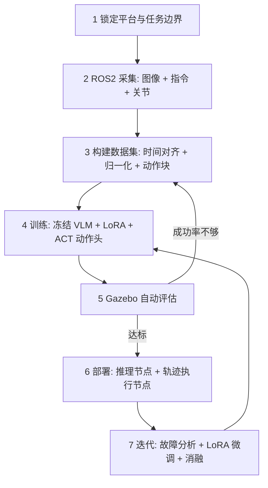

## 💡 一句话总结

> 不预训练大模型，也不追 SOTA：复用现成 VLM 提语义、自己训一个 ACT 动作头、用 ROS2 把「看到 + 听懂 → 动作」的闭环接起来，跑通一个属于自己的轻量化 VLA。

## 🎯 为什么需要它？

把 VLA 想成开餐厅。OpenVLA、π0 是连锁总部的中央厨房——菜谱、供应链、几千家门店的运营数据都齐了；你们是校内小馆子，第一步不是建中央厨房，而是先把「点单 → 出菜」这条线跑通。

很多同学一上来就对标 7B 基座，结果卡在显存和数据上，半年拿不出 demo。判断标准应当是：**能不能在 Gazebo 里用一句话让机械臂把红色方块放进蓝盒子**，而不是模型有多少参数。

所以先定预期：你们做的是**自制的轻量语言条件策略**，可以叫「自研简化版 VLA」。学术上 VLA 指视觉-语言-动作联合建模；工程上，你们真正需要的是让 VLM 提供开放世界语义、动作头输出连续轨迹。

这也决定了路线：**复用权重 + 自己搭动作头 + 模仿学习**，而不是从零预训练一个多模态大模型。

## 🔄 核心工作流程

整个项目是七步闭环。最容易翻车的是第 1 步——任务范围定太大，后面的努力全是还债。



| 阶段 | 关键动作 | 阶段产出 |
| --- | --- | --- |
| 1 定边界 | 单桌面、单步拾取、3 条固定指令 | 任务清单与验收标准 |
| 2 采集 | 固定频率同步图像与关节 | 每任务几百条轨迹 |
| 3 数据 | 对齐时间戳、归一化动作、切动作块 | 训练/验证集 |
| 4 训练 | 冻结主干，只训 LoRA + ACT | 可推理的权重 |
| 5 评估 | Gazebo 自动跑成功率 | 成功率曲线 |
| 6 部署 | 推理节点 + IK 执行 + 安全层 | ROS2 闭环 |
| 7 迭代 | 失败案例分类、消融 | 下一版方案 |

平台就按低成本来配：仿真用 TurtleBot3 加虚拟 6DoF 机械臂（Gazebo + ROS 2 Humble/Jazzy），真机选 uArm 这类便宜机械臂，传感器只要单目 RGB，最多加一个夹爪开合状态。别一开始上灵巧手和力控。

## 🧩 核心逻辑拆解

### 1. 通俗比喻

学徒跟师傅学手艺：师傅不写公式，只当面做一遍，学徒看完照着模仿。VLM 像一双已经读过很多书的眼睛，动作头像手上的肌肉记忆——眼睛不用重学，练手就行。

### 2. 技术实现

架构尽量简单，一层 VLM 加一层动作头：

```text
RGB 图像 + 语言指令
        ↓
VLM 编码器（Qwen-VL-2B / LLaVA-1.5 / OpenVLA 主干；冻结 + LoRA）
        ↓
多模态特征向量
        ↓
ACT 动作头（一次预测未来 K 步）
        ↓
动作块 [x, y, z, roll, pitch, yaw, gripper]
```

选型上，Qwen-VL-2B 加 ACT 在 16G 显存的 4060 上就能训；换 LLaVA-7B 建议至少 24G。动作头优先 ACT：代码干净、LeRobot 原生支持、对算力友好；Diffusion Policy 效果更好但调参更烦；flow matching 是 π0 的路线，入门材料少，不适合首发版本。**不要自己从零写 Transformer 动作头**，直接在 LeRobot 的 ACT 上把文本编码换成你选的 VLM，这就是自制 VLA。

数据侧一条样本是三元组：观测图像、自然语言指令、未来一段动作块。采集可以用主从示教，也可以写脚本在 Gazebo 里随机摆物体自动生成。两个细节决定成败：

- **时间对齐**：图像和关节必须按同一时间戳重采样，差一帧学出来就是反应慢半拍；
- **动作归一化**：按维度压到 `[-1, 1]`，关节范围差异大时不做归一化，loss 会看着降、跑起来乱抖。

指令统一成模板，比如 `Instruct: put the red block in the blue box`，同一动作多写几种说法，否则模型只认一种句式。你们熟悉的 YOLO 别浪费：可以自动检测物体、生成指令，省人工标注。

训练循环很朴素，复杂度都在数据里：

```python
for batch in loader:
    img, text, act = batch["image"], batch["instruction"], batch["action"]
    feat = vlm.encode(img, text)          # 冻结主干 + LoRA
    pred = act_head(feat)                 # (B, K, 7)
    loss = mse(pred, act)                 # 缺失维度先 mask
    loss.backward()
    opt.step()                            # 只更新 LoRA 与动作头
```

部署拆成两个 ROS2 节点，这是你们相对其他团队最大的优势：

1. **推理节点**：订阅 `/camera/image_raw` 和指令话题，跑模型，输出一段动作块；
2. **执行节点**：接动作块，做逆运动学，发给 `/joint_trajectory_controller`，并加限位、碰撞检测、超时停止。

关键在时序：VLA 输出的是接下来 K 步的轨迹，不是单步。执行一部分后重新取一帧图像再推理，刷新后续轨迹，闭环才成立。传统方案是「YOLO 检测 → 算坐标 → 写死抓取轨迹」，物体偏一点就失败；端到端策略直接从画面和一句话里出轨迹，容错更好。

答辩需要对比，建议做三组：

| 方案 | 语义来源 | 动作生成 | 作用 |
| --- | --- | --- | --- |
| 基线 1 | YOLO 检测结果 | 人工写的固定抓取规划 | 证明端到端有增益 |
| 基线 2 | CLIP 文本编码 | ACT | 证明完整 VLM 比 CLIP 更强 |
| 自研 VLA | VLM（LoRA） | ACT | 主方案 |

再加三个便宜的消融：冻结 VLM 对比开 LoRA、长动作块对比短动作块、是否喂历史帧。每组只改一个变量，结论才站得住。

## ⚠️ 常见坑点与注意事项

| 现象 | 原因 | 怎么绕开 |
| --- | --- | --- |
| 做了两个月还在调任务 | 任务范围太大，长时序误差累积 | 先做单步拾取，验收标准写死 |
| loss 降但真机乱抖 | 时间戳没对齐、动作没归一化 | 固定 5–10Hz 采集，按时间戳重采样，动作压到 [-1,1] |
| 显存爆炸、验证集过拟合 | 把 VLM 全量放开训练 | 冻结主干，只训 LoRA 与动作头 |
| 长任务永远失败 | 把 VLA 当全局规划器 | VLA 是局部反应策略；长任务交给上层 LLM 拆子任务 |
| 真机撞台面 | 没有安全层 | 限位、急停、超时停止三件套先写 |
| 只看 loss 就宣布成功 | 离线指标不等于成功率 | 每轮在 Gazebo 里跑固定初始状态，至少 20 次统计成功率 |

还有一条隐性坑：**别在笔记本 CPU 上硬训**。租短时 GPU 或借实验室机器，省下来的时间够你多采几百条数据。

## 📝 总结

- 路线一句话：复用 VLM 的语义能力，自建 ACT 动作头，用模仿学习训练，再用 ROS2 接成闭环；目标是跑通与展示，不是刷 SOTA。
- 两个版本可选：稳妥毕设版（Gazebo + 6DoF + Qwen-VL-2B + ACT + 几百条示教 + YOLO 基线），进阶竞赛版（真机 + 历史帧 + flow matching + 失败重规划）。
- 有余力就上分层：小 LLM 拆子任务 → VLA 执行单条子指令 → ROS2 控制器做轨迹跟踪与保护。这个架构既能藏住 VLA 的长时序短板，又能讲出一个完整系统。
